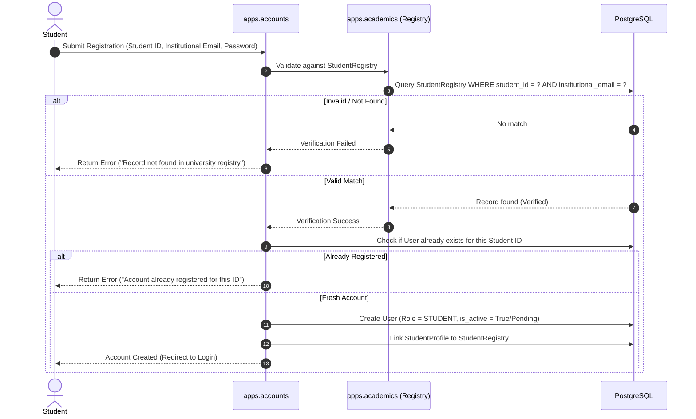
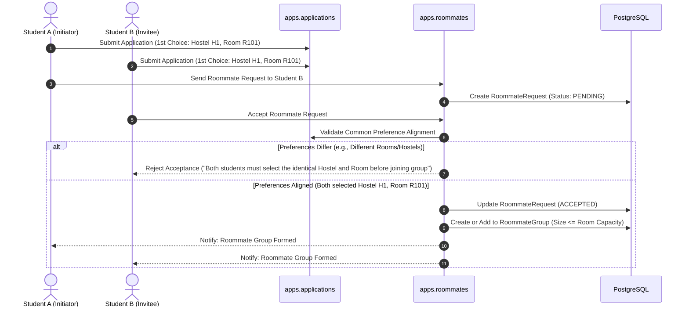
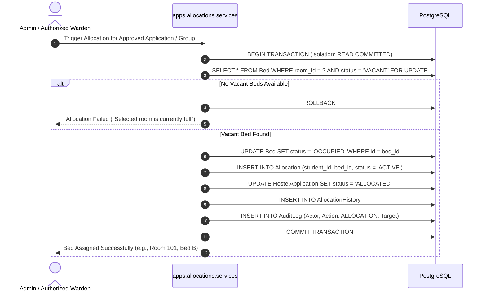

# System Architecture & Technical Design
## Hostel Allocation & Roommate Matching System

**Document Version:** 1.0.0  
**Phase:** Phase 1 — Planning and Architecture  
**Target Environment:** Django 6.1, PostgreSQL 15+, Gunicorn, NGINX  

---

## 1. Architectural Philosophy

The system is constructed as a **modular Django monolith**. It balances high developer velocity, clear boundaries, and database-level transactional integrity while avoiding the operational complexity of microservices or distributed systems.

### Core Principles
1. **Separation of Concerns:** Business logic is encapsulated in isolated service layers (`services/`) rather than scattered across Django views or bloated model methods.
2. **Database-Level Integrity:** Concurrency safety (preventing over-allocation or double booking) is guaranteed at the database engine level via transactions and row-level locks, not merely through in-memory Python checks.
3. **Strict Role-Based Scoping:** Authorization is enforced at the query level. Wardens can never access or modify resources outside their designated hostel assignments.
4. **Deterministic & Explainable:** Roommate compatibility is computed using transparent mathematical weighting in pure Python with zero external API dependencies or opaque ML models.

---

## 2. Layered Architecture Diagram

```
+-------------------------------------------------------------------------+
|                          Presentation Layer                             |
|  - Server-Rendered Django Templates (HTML5, Semantic CSS3, Vanilla JS)  |
|  - Responsive Grid / Flexbox (No CSS Frameworks, No React/Tailwind)     |
+------------------------------------+------------------------------------+
                                     | HTTP / WebSocket
                                     v
+------------------------------------+------------------------------------+
|                         Reverse Proxy & Cache                           |
|  - NGINX: SSL Termination, Static/Media Compression, Rate Limiting     |
+------------------------------------+------------------------------------+
                                     | Unix Socket / WSGI
                                     v
+------------------------------------+------------------------------------+
|                         Application Server                              |
|  - Gunicorn Workers (Sync / Gthread)                                    |
+------------------------------------+------------------------------------+
                                     |
                                     v
+------------------------------------+------------------------------------+
|                         Django Core Monolith                            |
|  - Middleware: CSRF, Security, Authentication, RBAC, Audit Logging      |
|  - URL Routing & Role-Restricted Class/Function Views                   |
+------------------------------------+------------------------------------+
                                     |
                                     v
+------------------------------------+------------------------------------+
|                         Domain Service Layer                            |
|  - VerificationService        - CompatibilityAlgorithmService           |
|  - RoommateGroupService       - AllocationEngineService (Locks)         |
|  - OccupancyReportingService  - NotificationService                     |
+------------------------------------+------------------------------------+
                                     |
                                     v
+------------------------------------+------------------------------------+
|                          Data Access Layer                              |
|  - Django ORM (select_related, prefetch_related, select_for_update)     |
+------------------------------------+------------------------------------+
                                     | psycopg
                                     v
+------------------------------------+------------------------------------+
|                        PostgreSQL Database                              |
|  - ACID Engine: Pessimistic Row Locking, Composite Indexes, Foreign Keys|
+-------------------------------------------------------------------------+
```

---

## 3. Modular App Boundaries

The application is structured into 10 decoupled apps located within the `apps/` directory:

| App Name | Responsibilities | Key Models & Components |
|---|---|---|
| `apps.accounts` | Custom user entity, authentication, role enforcement, session management, rate-limiting. | `User`, `Role`, `RegistrationToken` |
| `apps.academics` | University academic hierarchy and verified registry pre-population. | `University`, `Department`, `DegreeProgram`, `Branch`, `AdmissionBatch`, `StudentRegistry`, `StudentEnrollment` |
| `apps.students` | Student profile enrichment, verified status display, personal details. | `StudentProfile` |
| `apps.hostels` | Physical accommodation inventory, rooms, capacities, facilities, warden assignments. | `Hostel`, `Block`, `Floor`, `Room`, `Bed`, `Facility`, `RoomFacility`, `WardenAssignment` |
| `apps.applications` | Cycle definitions, student application lifecycle, priority choices. | `AccommodationCycle`, `HostelApplication`, `ApplicationChoice`, `ApplicationStatusHistory` |
| `apps.roommates` | 7-factor questionnaire, compatibility algorithm, mutual requests, group formation. | `RoommatePreference`, `RoommateGroup`, `RoommateGroupMember`, `RoommateRequest`, `MatchScore` |
| `apps.allocations` | Transactional allocation engine, bed assignment, locking, reallocations. | `Allocation`, `AllocationHistory` |
| `apps.notifications` | In-app alerts, transactional events, notification center. | `Notification` |
| `apps.reports` | Occupancy calculations, capacity charts, administrative summaries. | Reporting views & export services |
| `apps.audit` | Non-repudiation audit logging for administrative and allocation events. | `AuditLog` |

---

## 4. Key Workflows & Sequence Diagrams

### 4.1 Verification & Registration Workflow



---

### 4.2 Application & Roommate Group Alignment Workflow



---

### 4.3 Transactional Allocation Engine with Pessimistic Locking



---

## 5. Security & Concurrency Design

### 5.1 Concurrency & Overbooking Elimination
* In university room allocations, multiple students or administrative approval officers may attempt to allocate or claim the same room simultaneously.
* The system uses **Pessimistic Row-Level Locking**:
  ```python
  with transaction.atomic():
      available_bed = Bed.objects.select_for_update().filter(
          room=selected_room,
          status=BedStatus.VACANT
      ).first()
      if not available_bed:
          raise RoomCapacityExceededException("No vacant beds remaining in room.")
      
      available_bed.status = BedStatus.OCCUPIED
      available_bed.save()
      
      Allocation.objects.create(
          student=student,
          bed=available_bed,
          is_active=True,
          cycle=active_cycle
      )
  ```
* Additionally, a **Database Unique Constraint** enforces that a `Bed` cannot have more than one active `Allocation` concurrently:
  `UniqueConstraint(fields=['bed'], condition=Q(is_active=True), name='unique_active_bed_allocation')`
* Similarly, a student cannot have more than one active allocation concurrently:
  `UniqueConstraint(fields=['student'], condition=Q(is_active=True), name='unique_active_student_allocation')`

### 5.2 Role-Based Access Control Matrix

| Feature / Action | Student | Hostel Warden | Administrator |
|---|:---:|:---:|:---:|
| Verify ID & Register | Yes | No | No |
| Fill 7-Factor Lifestyle Form | Yes | No | No |
| Send / Accept Roommate Requests | Yes | No | No |
| Submit Hostel Application | Yes | No | No |
| View Assigned Hostel Occupancy | No | Yes (Assigned Hostels Only) | Yes (Universal) |
| Review Applications | No | Yes (Assigned Hostels Only) | Yes (Universal) |
| Delegated Allocation Approval | No | Yes (If Delegated by Admin) | Yes (Full Authority) |
| Manage Hostels / Blocks / Rooms | No | No | Yes |
| Import Student Registry | No | No | Yes |
| System Config & Full Audit Logs | No | No | Yes |

