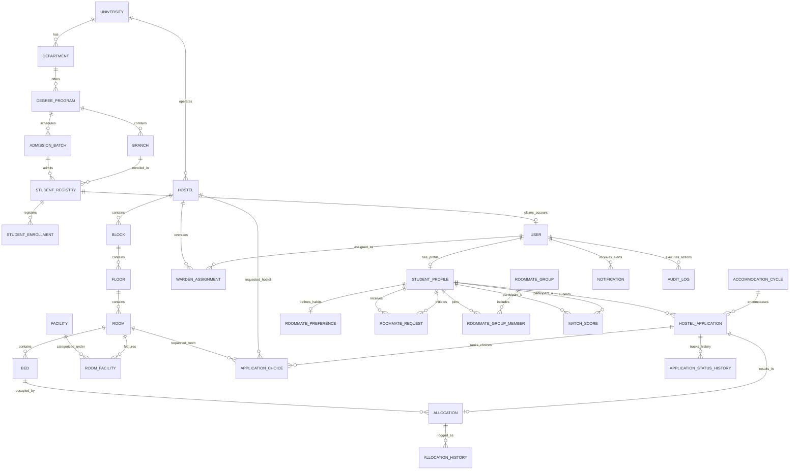

# Database Design & Entity Relationship Specification
## Hostel Allocation & Roommate Matching System

**Document Version:** 1.0.0  
**Phase:** Phase 1 — Planning and Architecture  
**Database Engine:** PostgreSQL 15+ (Production) / SQLite (Dev Testing with migrations mapped to Postgres)  

---

## 1. Entity Relationship Diagram (ERD)

---

## 2. Table Specifications & Data Dictionaries

### 2.1 Identity & Authentication (`apps.accounts`)

#### Table: `accounts_user`
Custom User model replacing Django's default `auth.User`. Supports email and Student ID authentication.

| Column | Data Type | Constraints | Description |
|---|---|---|---|
| `id` | `BIGSERIAL` | Primary Key | Internal surrogate key |
| `email` | `VARCHAR(254)` | Unique, Not Null, Indexed | Institutional or login email |
| `student_id_login` | `VARCHAR(32)` | Unique, Nullable, Indexed | Student ID (for student logins) |
| `password` | `VARCHAR(128)` | Not Null | PBKDF2 with SHA-256 password hash |
| `role` | `VARCHAR(20)` | Not Null, Default: `'STUDENT'` | Choice: `ADMIN`, `WARDEN`, `STUDENT` |
| `is_active` | `BOOLEAN` | Not Null, Default: `True` | Account active state |
| `is_staff` | `BOOLEAN` | Not Null, Default: `False` | Staff access flag |
| `is_superuser` | `BOOLEAN` | Not Null, Default: `False` | Superuser flag |
| `date_joined` | `TIMESTAMPTZ` | Not Null, Default: `NOW()` | Timestamp of registration |
| `last_login` | `TIMESTAMPTZ` | Nullable | Timestamp of last login |

---

### 2.2 Academic Structure & Official Registry (`apps.academics`)

#### Table: `academics_university`
| Column | Data Type | Constraints | Description |
|---|---|---|---|
| `id` | `SERIAL` | Primary Key | University identifier |
| `name` | `VARCHAR(200)` | Unique, Not Null | Full university name |
| `code` | `VARCHAR(30)` | Unique, Not Null | University short code (e.g., 'LPU') |

#### Table: `academics_department`
| Column | Data Type | Constraints | Description |
|---|---|---|---|
| `id` | `SERIAL` | Primary Key | Department identifier |
| `university_id` | `INT` | FK -> `academics_university.id` | University parent |
| `name` | `VARCHAR(150)` | Not Null | Department name (e.g., 'School of CSE') |
| `code` | `VARCHAR(30)` | Not Null | Department code |

#### Table: `academics_degreeprogram`
| Column | Data Type | Constraints | Description |
|---|---|---|---|
| `id` | `SERIAL` | Primary Key | Program identifier |
| `department_id` | `INT` | FK -> `academics_department.id` | Department parent |
| `name` | `VARCHAR(150)` | Not Null | Degree name (e.g., 'Bachelor of Technology') |
| `duration_years`| `SMALLINT` | Not Null, Check: `> 0` | Standard duration in years |

#### Table: `academics_branch`
| Column | Data Type | Constraints | Description |
|---|---|---|---|
| `id` | `SERIAL` | Primary Key | Branch identifier |
| `program_id` | `INT` | FK -> `academics_degreeprogram.id` | Degree program parent |
| `name` | `VARCHAR(150)` | Not Null | Branch name (e.g., 'Computer Science & Engineering') |
| `code` | `VARCHAR(30)` | Not Null | Branch code (e.g., 'CSE') |

#### Table: `academics_admissionbatch`
| Column | Data Type | Constraints | Description |
|---|---|---|---|
| `id` | `SERIAL` | Primary Key | Batch identifier |
| `program_id` | `INT` | FK -> `academics_degreeprogram.id` | Program parent |
| `year` | `INT` | Not Null | Admission year (e.g., 2024) |

#### Table: `academics_studentregistry`
The official pre-imported registrar table. Contains authoritative records used for verification.

| Column | Data Type | Constraints | Description |
|---|---|---|---|
| `id` | `BIGSERIAL` | Primary Key | Registry record identifier |
| `student_id` | `VARCHAR(32)` | Unique, Not Null, Indexed | Official student ID / Registration Number |
| `full_name` | `VARCHAR(150)` | Not Null | Full official legal name |
| `institutional_email` | `VARCHAR(254)` | Unique, Not Null, Indexed | Official university email |
| `gender` | `VARCHAR(10)` | Not Null | Choice: `'MALE'`, `'FEMALE'`, `'OTHER'` |
| `date_of_birth` | `DATE` | Not Null | Official date of birth |
| `phone_number` | `VARCHAR(20)` | Nullable | Contact telephone number |
| `branch_id` | `INT` | FK -> `academics_branch.id` | Academic branch |
| `batch_id` | `INT` | FK -> `academics_admissionbatch.id`| Admission batch |
| `is_registered` | `BOOLEAN` | Not Null, Default: `False` | True once user creates linked account |
| `enrollment_status` | `VARCHAR(20)`| Not Null, Default: `'ACTIVE'` | Choice: `'ACTIVE'`, `'SUSPENDED'`, `'ALUMNI'` |

#### Table: `academics_studentenrollment`
| Column | Data Type | Constraints | Description |
|---|---|---|---|
| `id` | `BIGSERIAL` | Primary Key | Enrollment identifier |
| `registry_id` | `BIGINT` | FK -> `academics_studentregistry.id` | Student registry reference |
| `academic_year` | `VARCHAR(20)` | Not Null | E.g., `'2026-2027'` |
| `semester` | `SMALLINT` | Not Null, Check: `1..12` | Current enrolled semester |
| `status` | `VARCHAR(20)` | Not Null, Default: `'CURRENT'` | Enrollment status |

---

### 2.3 Student Profile (`apps.students`)

#### Table: `students_studentprofile`
| Column | Data Type | Constraints | Description |
|---|---|---|---|
| `id` | `BIGSERIAL` | Primary Key | Profile identifier |
| `user_id` | `BIGINT` | OneToOne -> `accounts_user.id` | Linked authentication user |
| `registry_id` | `BIGINT` | OneToOne -> `academics_studentregistry.id` | Linked official registry data |
| `emergency_contact_name` | `VARCHAR(100)` | Nullable | Guardian/emergency contact |
| `emergency_contact_phone` | `VARCHAR(20)` | Nullable | Guardian emergency phone |
| `profile_completed` | `BOOLEAN` | Not Null, Default: `False` | Flag indicating profile readiness |

---

### 2.4 Accommodation Structure & Facilities (`apps.hostels`)

#### Table: `hostels_hostel`
| Column | Data Type | Constraints | Description |
|---|---|---|---|
| `id` | `SERIAL` | Primary Key | Hostel identifier |
| `university_id` | `INT` | FK -> `academics_university.id` | University parent |
| `name` | `VARCHAR(100)` | Unique, Not Null | Hostel name (e.g., 'Boys Hostel 1') |
| `code` | `VARCHAR(20)` | Unique, Not Null | Short code (e.g., 'BH-1') |
| `gender_policy` | `VARCHAR(10)` | Not Null | Choice: `'MALE'`, `'FEMALE'`, `'CO_ED'` |
| `status` | `VARCHAR(20)` | Not Null, Default: `'ACTIVE'` | Choice: `'ACTIVE'`, `'MAINTENANCE'`, `'INACTIVE'` |
| `total_capacity` | `INT` | Not Null, Default: 0 | Total bed capacity |

#### Table: `hostels_wardenassignment`
| Column | Data Type | Constraints | Description |
|---|---|---|---|
| `id` | `SERIAL` | Primary Key | Assignment record |
| `user_id` | `BIGINT` | FK -> `accounts_user.id` | Warden user account |
| `hostel_id` | `INT` | FK -> `hostels_hostel.id` | Assigned hostel |
| `can_approve_allocation` | `BOOLEAN` | Not Null, Default: `False` | Delegated approval permission flag |
| `is_active` | `BOOLEAN` | Not Null, Default: `True` | Active status |

#### Table: `hostels_block`
| Column | Data Type | Constraints | Description |
|---|---|---|---|
| `id` | `SERIAL` | Primary Key | Block identifier |
| `hostel_id` | `INT` | FK -> `hostels_hostel.id` | Parent hostel |
| `name` | `VARCHAR(50)` | Not Null | Block identifier (e.g., 'Block A') |

#### Table: `hostels_floor`
| Column | Data Type | Constraints | Description |
|---|---|---|---|
| `id` | `SERIAL` | Primary Key | Floor identifier |
| `block_id` | `INT` | FK -> `hostels_block.id` | Parent block |
| `floor_number`| `SMALLINT` | Not Null | Floor level (0 = Ground, 1, 2, ...) |

#### Table: `hostels_room`
| Column | Data Type | Constraints | Description |
|---|---|---|---|
| `id` | `SERIAL` | Primary Key | Room identifier |
| `floor_id` | `INT` | FK -> `hostels_floor.id` | Parent floor |
| `room_number` | `VARCHAR(20)` | Not Null | E.g., '101', 'A-204' |
| `capacity` | `SMALLINT` | Not Null, Check: `1..4` | Total bed count (1, 2, 3, or 4) |
| `washroom_type` | `VARCHAR(20)` | Not Null, Default: `'ATTACHED'` | Choice: `'ATTACHED'`, `'SHARED'` |
| `is_air_conditioned` | `BOOLEAN` | Not Null, Default: `False` | AC facility indicator |
| `status` | `VARCHAR(20)` | Not Null, Default: `'AVAILABLE'` | Choice: `'AVAILABLE'`, `'FULL'`, `'MAINTENANCE'` |

#### Table: `hostels_bed`
| Column | Data Type | Constraints | Description |
|---|---|---|---|
| `id` | `SERIAL` | Primary Key | Bed identifier |
| `room_id` | `INT` | FK -> `hostels_room.id` | Parent room |
| `bed_identifier` | `VARCHAR(10)` | Not Null | E.g., 'A', 'B', 'C', 'D' |
| `status` | `VARCHAR(20)` | Not Null, Default: `'VACANT'` | Choice: `'VACANT'`, `'OCCUPIED'`, `'RESERVED'`, `'MAINTENANCE'` |

#### Table: `hostels_facility` & `hostels_roomfacility`
Supports dynamic room amenities (Geyser, Balcony, Study Desk, High-speed LAN).

---

### 2.5 Applications & Cycle Management (`apps.applications`)

#### Table: `applications_accommodationcycle`
| Column | Data Type | Constraints | Description |
|---|---|---|---|
| `id` | `SERIAL` | Primary Key | Cycle identifier |
| `academic_year` | `VARCHAR(20)` | Not Null | E.g., '2026-2027' |
| `semester` | `SMALLINT` | Not Null | E.g., 1 or 2 |
| `application_start` | `TIMESTAMPTZ` | Not Null | Application window opening date/time |
| `application_end` | `TIMESTAMPTZ` | Not Null | Application window closing date/time |
| `is_active` | `BOOLEAN` | Not Null, Default: `False` | Current active cycle flag |

#### Table: `applications_hostelapplication`
| Column | Data Type | Constraints | Description |
|---|---|---|---|
| `id` | `BIGSERIAL` | Primary Key | Application identifier |
| `student_id` | `BIGINT` | FK -> `students_studentprofile.id` | Applicant profile |
| `cycle_id` | `INT` | FK -> `applications_accommodationcycle.id`| Target cycle |
| `status` | `VARCHAR(20)` | Not Null, Default: `'SUBMITTED'` | Choice: `'DRAFT'`, `'SUBMITTED'`, `'UNDER_REVIEW'`, `'APPROVED'`, `'ALLOCATED'`, `'WAITLISTED'`, `'REJECTED'`, `'CANCELLED'` |
| `submitted_at` | `TIMESTAMPTZ` | Not Null, Default: `NOW()` | Submission timestamp |
| `reviewed_by_id` | `BIGINT` | Nullable, FK -> `accounts_user.id` | Reviewing Admin / Warden |
| `reviewed_at` | `TIMESTAMPTZ` | Nullable | Review timestamp |
| `review_notes` | `TEXT` | Nullable | Administrative notes |

*Constraint:* Unique constraint `(student_id, cycle_id)` ensuring **exactly one application per student per cycle**.

#### Table: `applications_applicationchoice`
Supports up to 3 prioritized hostel/room choices.

| Column | Data Type | Constraints | Description |
|---|---|---|---|
| `id` | `BIGSERIAL` | Primary Key | Choice identifier |
| `application_id`| `BIGINT` | FK -> `applications_hostelapplication.id` | Parent application |
| `hostel_id` | `INT` | FK -> `hostels_hostel.id` | Chosen hostel |
| `room_id` | `INT` | Nullable, FK -> `hostels_room.id` | Preferred specific room |
| `priority` | `SMALLINT` | Not Null, Check: `1..3` | Priority preference rank (1 = Highest) |

*Constraint:* Unique constraint `(application_id, priority)` to prevent duplicate rank assignments.

#### Table: `applications_applicationstatushistory`
Immutable audit log of all application status changes.

---

### 2.6 Roommates & Compatibility Engine (`apps.roommates`)

#### Table: `roommates_roommatepreference`
Stores the 7 lifestyle factors (scaled 1 to 5). Smoking is completely omitted.

| Column | Data Type | Constraints | Description |
|---|---|---|---|
| `id` | `BIGSERIAL` | Primary Key | Preference identifier |
| `student_id` | `BIGINT` | OneToOne -> `students_studentprofile.id` | Student reference |
| `sleeping_schedule` | `SMALLINT` | Not Null, Check: `1..5` | 1 = Very Early Riser, 5 = Night Owl |
| `cleanliness` | `SMALLINT` | Not Null, Check: `1..5` | 1 = Relaxed, 5 = Extremely Tidy |
| `study_habits` | `SMALLINT` | Not Null, Check: `1..5` | 1 = Absolute Silence, 5 = Group / Music |
| `noise_tolerance` | `SMALLINT` | Not Null, Check: `1..5` | 1 = Very Sensitive, 5 = Highly Tolerant |
| `food_preference` | `VARCHAR(20)` | Not Null | Choices: `'VEGETARIAN'`, `'NON_VEGETARIAN'`, `'FLEXIBLE'` |
| `social_preference`| `SMALLINT` | Not Null, Check: `1..5` | 1 = Introverted/Quiet, 5 = Highly Social/Guests |
| `temperature_pref` | `SMALLINT` | Not Null, Check: `1..5` | 1 = Warm/No AC, 5 = Cold/Continuous AC |
| `updated_at` | `TIMESTAMPTZ` | Not Null, Default: `NOW()` | Timestamp of last preference update |

#### Table: `roommates_roommaterequest`
Direct mutual roommate pairing requests via Student ID.

| Column | Data Type | Constraints | Description |
|---|---|---|---|
| `id` | `BIGSERIAL` | Primary Key | Request identifier |
| `sender_id` | `BIGINT` | FK -> `students_studentprofile.id` | Requesting student |
| `receiver_id` | `BIGINT` | FK -> `students_studentprofile.id` | Targeted student |
| `cycle_id` | `INT` | FK -> `applications_accommodationcycle.id`| Application cycle |
| `status` | `VARCHAR(20)` | Not Null, Default: `'PENDING'` | Choice: `'PENDING'`, `'ACCEPTED'`, `'REJECTED'`, `'EXPIRED'`, `'CANCELLED'` |
| `created_at` | `TIMESTAMPTZ` | Not Null, Default: `NOW()` | Created timestamp |
| `responded_at` | `TIMESTAMPTZ` | Nullable | Response timestamp |

*Constraint:* Check constraint `sender_id != receiver_id` (a student cannot request themselves).

#### Table: `roommates_roommategroup` & `roommates_roommategroupmember`
Enables forming mutual groups of 2, 3, or 4 students.

| Column | Data Type | Constraints | Description |
|---|---|---|---|
| `id` | `BIGSERIAL` | Primary Key | Group identifier |
| `cycle_id` | `INT` | FK -> `applications_accommodationcycle.id`| Active cycle |
| `target_room_id`| `INT` | FK -> `hostels_room.id` | Common room aligned by all members |
| `is_confirmed` | `BOOLEAN` | Not Null, Default: `False` | Confirmed when all members align and accept |

*Constraint:* Group membership count cannot exceed `target_room.capacity`.

#### Table: `roommates_matchscore`
Pre-calculated or cached compatibility scores between students.

| Column | Data Type | Constraints | Description |
|---|---|---|---|
| `id` | `BIGSERIAL` | Primary Key | Score identifier |
| `student_a_id` | `BIGINT` | FK -> `students_studentprofile.id` | Student A (Lesser ID) |
| `student_b_id` | `BIGINT` | FK -> `students_studentprofile.id` | Student B (Greater ID) |
| `score` | `DECIMAL(5, 2)` | Not Null, Check: `0.00..100.00` | Percentage score (0.00% to 100.00%) |
| `algorithm_version`| `VARCHAR(20)` | Not Null, Default: `'v1.0'` | Version tag of algorithm |
| `calculated_at`| `TIMESTAMPTZ` | Not Null, Default: `NOW()` | Calculation timestamp |

*Constraint:* Unique constraint `(student_a_id, student_b_id)` with `CHECK (student_a_id < student_b_id)` to enforce symmetry and eliminate duplicate pairs.

---

### 2.7 Allocations & Locking Engine (`apps.allocations`)

#### Table: `allocations_allocation`
The active, confirmed bed assignment.

| Column | Data Type | Constraints | Description |
|---|---|---|---|
| `id` | `BIGSERIAL` | Primary Key | Allocation identifier |
| `student_id` | `BIGINT` | FK -> `students_studentprofile.id` | Allocated student |
| `bed_id` | `INT` | FK -> `hostels_bed.id` | Assigned bed |
| `application_id`| `BIGINT` | OneToOne -> `applications_hostelapplication.id` | Linked application |
| `cycle_id` | `INT` | FK -> `applications_accommodationcycle.id`| Accommodation cycle |
| `allocated_by_id`| `BIGINT`| FK -> `accounts_user.id` | Approving administrator or authorized warden |
| `start_date` | `DATE` | Not Null | Occupancy start date |
| `end_date` | `DATE` | Not Null | Occupancy end date |
| `is_active` | `BOOLEAN` | Not Null, Default: `True` | Active allocation state |
| `created_at` | `TIMESTAMPTZ` | Not Null, Default: `NOW()` | Timestamp |

*Critical Concurrency Constraints:*
- `EXCLUDE USING gist (bed_id WITH =, daterange(start_date, end_date) WITH &&) WHERE (is_active = TRUE)` — Prevents any overlapping occupancy on the same bed.
- `EXCLUDE USING gist (student_id WITH =, daterange(start_date, end_date) WITH &&) WHERE (is_active = TRUE)` — Prevents a student from holding multiple simultaneous active bed allocations.

#### Table: `allocations_allocationhistory`
Tracks reallocations, room transfers, and checkouts.

---

### 2.8 Notifications & Audit Logs (`apps.notifications` & `apps.audit`)

#### Table: `notifications_notification`
| Column | Data Type | Constraints | Description |
|---|---|---|---|
| `id` | `BIGSERIAL` | Primary Key | Notification identifier |
| `recipient_id` | `BIGINT` | FK -> `accounts_user.id` | User receiving alert |
| `title` | `VARCHAR(150)` | Not Null | Headline summary |
| `message` | `TEXT` | Not Null | Full notification content |
| `notification_type` | `VARCHAR(30)` | Not Null | Type (e.g., `'ROOMMATE_REQ'`, `'ALLOCATION_APPROVED'`) |
| `is_read` | `BOOLEAN` | Not Null, Default: `False` | Read status |
| `created_at` | `TIMESTAMPTZ` | Not Null, Default: `NOW()` | Creation timestamp |

#### Table: `audit_auditlog`
| Column | Data Type | Constraints | Description |
|---|---|---|---|
| `id` | `BIGSERIAL` | Primary Key | Audit identifier |
| `actor_id` | `BIGINT` | Nullable, FK -> `accounts_user.id` | User performing action (Null = System) |
| `action` | `VARCHAR(50)` | Not Null | E.g., `'ALLOCATION_APPROVED'`, `'REALLOCATION'` |
| `target_model` | `VARCHAR(50)` | Not Null | E.g., `'Allocation'`, `'HostelApplication'` |
| `target_id` | `VARCHAR(50)` | Not Null | Primary key of target entity |
| `ip_address` | `INET` | Nullable | Origin IP address |
| `changes_json` | `JSONB` | Nullable | Pre- and post-change snapshot diff |
| `timestamp` | `TIMESTAMPTZ` | Not Null, Default: `NOW()` | Immutable timestamp |

---

## 3. Database Indexing & Performance Strategy

To ensure sub-100ms response times and support scaling up to 10 million synthetic student records, the following indexing strategy is enforced:

| Table | Index Name | Columns | Purpose |
|---|---|---|---|
| `accounts_user` | `idx_user_email_active` | `(email, is_active)` | Accelerated login lookups |
| `academics_studentregistry` | `idx_registry_lookup` | `(student_id, institutional_email)` | O(1) registration identity verification |
| `hostels_room` | `idx_room_floor_status` | `(floor_id, status)` | Floor plan rendering and occupancy filtering |
| `hostels_bed` | `idx_bed_room_status` | `(room_id, status)` | Fast retrieval of vacant beds during allocation |
| `applications_hostelapplication` | `idx_app_student_cycle` | `(student_id, cycle_id)` | Enforcing single application and fetching student status |
| `applications_hostelapplication` | `idx_app_cycle_status` | `(cycle_id, status)` | Admin / Warden queue filtering |
| `roommates_matchscore` | `idx_matchscore_pair` | `(student_a_id, student_b_id)` | Instant compatibility lookup |
| `allocations_allocation` | `idx_allocation_student_active` | `(student_id, is_active)` | Active residency validation |
| `allocations_allocation` | `idx_allocation_bed_active` | `(bed_id, is_active)` | Active bed occupancy queries |
| `audit_auditlog` | `idx_audit_actor_timestamp` | `(actor_id, timestamp)` | Compliance and security log audits |

